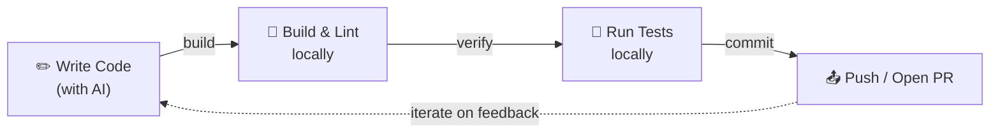
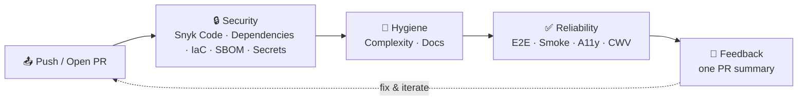

# Architecture

Structure and boundaries of the SlopStopper suite: a Python CLI that owns
every check, a set of GitHub Actions workflows that call it, and an
installer that lands both in an adopter's repository.

Notation: C4 (Context + Container).

## Routes

| When you are…                                                      | Do this                                                                       |
| ------------------------------------------------------------------ | ----------------------------------------------------------------------------- |
| choosing or changing a project-shape profile (`profile:` key, `--profile`), or adding a workflow a profile should drop | Read [PROFILES.md](PROFILES.md) for the `ui` / `api` / `library` mapping and its design decisions |
| changing how checks report on a PR (`slopstopper emit`, `ss-pr-summary.yml`, comment markers) | Read [PR_FEEDBACK.md](PR_FEEDBACK.md) for the one-summary + compact-comment design and why the summary reads GitHub, not the checks |

## Scope

- `slopstopper-cli` under `cli/`: one module per check, stdlib-only, each
  subprocess-invoking its tool (`snyk`, `gitleaks`, `lizard`, Playwright,
  Lighthouse) and writing `.ss/reports/<check>/`.
- The `ss-*.yml` workflows and the two composite actions under
  `.github/actions/`, copied into adopter repos by `install.sh`.
- This repository has no deployed surface. It runs under the `library`
  profile, so only the static layer (Snyk, secrets, complexity, the docs
  checks) gates its own PRs; the browser and API checks are exercised by
  the CLI tests and by adopters.

## Project Layout

`AGENTS.md` carries the top-level layout. What it leaves out:

```
.github/actions/          # Composite steps every ss-* workflow shares (ss-setup, ss-resolve-url)
.ss/                      # SlopStopper-owned, adopter side
├── reports/              # The CLI writes here (.gitignored)
├── .workflows-installed  # Manifest of installed workflows (commit this)
└── .installed-from       # slopstopper commit the install came from (commit this)
cli/slopstopper/
├── cli.py                # argparse dispatcher + bare-invocation banner
├── output.py             # Shared formatters + `--quiet` toggle
├── checks/               # One module per check; `_` modules are shared helpers (_snyk.py for the four Snyk checks)
├── data/                 # Bundled Playwright specs, lighthouserc dev/prod, server.js, profiles.json
└── templates.py / emit.py / discovery.py / config.py / profiles.py
mise.toml                 # Pins `task`, `node`, `npm:snyk` and `gitleaks` to exact versions; read locally and by jdx/mise-action
Taskfile.yml              # Thin root, `includes: { ss: ./Taskfile.ss.yml }`
```

## C4 – Level 1 (System Context)

```mermaid
flowchart LR
    D[Developer / agent]
    G[Adopter repository on GitHub]
    CI[GitHub Actions runner]
    S[Snyk tenant\napi.snyk.io or regional]
    R[This repository\ntagged releases]

    D -->|task ss:*| G
    G -->|PR / push| CI
    CI -->|git+source@ref#subdirectory=cli| R
    CI -->|snyk code test / test / iac test / sbom / monitor| S
    CI -->|PR comment, issue, artifacts| G
```

## C4 – Level 2 (Container)

```mermaid
flowchart LR
    WF[ss-*.yml workflow]
    SETUP[ss-setup composite action\nmise toolchain + pinned CLI]
    CLI[slopstopper-cli\nrun / emit / summary]
    SNYK[snyk CLI\npinned in mise.toml]
    GL[gitleaks\npinned in mise.toml]
    PW[Playwright + Lighthouse\n(ui profile only)]
    REP[.ss/reports/<check>/]
    GH[GitHub API via gh]

    WF --> SETUP --> CLI
    CLI -->|subprocess| SNYK
    CLI -->|subprocess| GL
    CLI -->|subprocess| PW
    CLI --> REP
    CLI -->|emit| GH
```

## Single-route invocation: `task ss:*`

SlopStopper exposes one canonical entry point for any check: `task ss:<category>:<name>`. Humans, agents AND CI all invoke through it, so the suite shares the same invocation surface as everything else in the codebase (`task build`, `task deploy`, `task lint`).

```
┌─────────────────────────────────────────────────────────────────┐
│  Humans / Agents / CI                                           │
│                                                                 │
│       task ss:hygiene:complexity                                │
│       task ss:reliability:smoke -- http://localhost:8080        │
│       task ss:security:scan                                     │
└────────────────────────┬────────────────────────────────────────┘
                         │   Taskfile.ss.yml shims
                         ▼
┌─────────────────────────────────────────────────────────────────┐
│  slopstopper-cli (Python, installed from a git tag)             │
│                                                                 │
│       slopstopper run <category>:<name> [--url URL] [--ci]      │
└────────────────────────┬────────────────────────────────────────┘
                         │   subprocess
                         ▼
┌─────────────────────────────────────────────────────────────────┐
│  External tools (snyk, gitleaks, lizard, playwright, ...)       │
└─────────────────────────────────────────────────────────────────┘
```

Adopters who don't want Task in their CI pass `--no-task` to `install.sh` and get workflows that call the CLI directly, with the same execution path, exit codes and reports. The Task layer is the surface to promote; the CLI is the implementation each shim calls into.

See [`Taskfile.ss.yml`](../../Taskfile.ss.yml) for the shipped shim catalogue.

## Toolchain: mise + Task + a git pin (why each)

SlopStopper deliberately uses **three** mechanisms with non-overlapping jobs.

| Mechanism | Job | Where it's defined |
| --------- | --- | ------------------ |
| **mise** | *Tool versions.* Pins and installs `task`, `node`, the `snyk` CLI and `gitleaks` at exact versions, then activates them **per-directory** | `mise.toml` (`[tools]`) |
| **`cli:` pin** | *The CLI version.* An exact git tag of this repository; CI installs `slopstopper-cli @ git+<source>@<ref>#subdirectory=cli` | `.slopstopper.yml` (`cli.source`, `cli.ref`), or the `SLOPSTOPPER_CLI_SPEC` variable for an internal index |
| **Task** | *Commands.* `task ss:<check>` is the single invocation surface | `Taskfile.ss.yml` shims |

Why mise owns the scanner versions: a security scanner that floats changes
its findings between two runs of the same commit, and an enterprise
reviewer needs to say which scanner version produced a given report. Exact
pins, moved by a reviewable PR, give that. mise keeps every version
side-by-side and rewrites `PATH` per-directory, so the active `snyk` follows
the repo, and `jdx/mise-action` reads the same file in CI.

Why the CLI is a git pin and not a mise tool: the CLI is not on a package
registry, and a tag of this repository is both the version everyone runs
and the thing a reviewer reads when the bump PR lands. An enterprise mirrors
the repository or builds the wheel once for an internal index; the pin
mechanism is the same either way.

`node` rides the mise mechanism: it's a tool version, so it lives in
`mise.toml` (not `.slopstopper.yml`) and CI gets it from `jdx/mise-action`,
so there is no separate `setup-node` step or repo variable. `install.sh`
seeds `node = "20"` into an adopter's `mise.toml` only when they haven't
already declared a Node version (`mise.toml` / `.node-version` / `.nvmrc`).

Why Task stays the interface: `task ss:<category>:<check>` sits alongside an adopter's own
`task build` / `task deploy`, so the suite shares their existing command surface
rather than introducing a parallel one. mise auto-installs `task`, so it remains a
one-install story.

In short: **mise installs the tools (pinned), the git tag pins the CLI, Task runs it.** Moving the CLI pin is editing `cli.ref` after re-running the installer from the new tag; see
[`docs/runbooks/UPGRADE_CLI.md`](../runbooks/UPGRADE_CLI.md).

## Development Loops

SlopStopper organises quality feedback into two loops. Together they keep velocity high while keeping quality consistent.

### Local Inner Loop

The fast, local cycle a developer (or AI agent) runs before pushing code. Completes in seconds to minutes.



The push step is backed by an automated gate: `install.sh` wires a **pre-push
hook** (`.githooks/pre-push`, via `core.hooksPath`) that runs the fast static
hygiene checks (`task ss:hygiene:test`) before every push, so the first CI run
confirms rather than discovers. It goes through `mise exec` (git hooks don't
source your shell profile) and reuses the same `task ss:hygiene:test` target that
CI runs, keeping one invocation surface across hook, local and CI. Only the
static hygiene checks run in the hook; the Snyk checks need a token and the
browser checks need a server, so both stay in the Outer Loop (or run by hand
with `task ss:security:scan`). The installer won't touch an existing hook manager
(husky / lefthook / pre-commit) or a custom `core.hooksPath`; pass `--no-hooks`
to skip it, and `git push --no-verify` bypasses a single push.

### CI/CD Outer Loop

The automated CI/CD pipeline triggered by every push or pull request. Each stage provides deterministic feedback before code reaches production.



### How the Loops Work Together

| Loop | Where | Speed | Triggered by |
|------|-------|-------|--------------|
| Inner | Local machine | Seconds – minutes | Developer action |
| Outer | GitHub Actions | Minutes | Push or PR |

When the outer loop flags an issue, the developer re-enters the inner loop to fix it. Because the outer loop is **deterministic** and runs the same checks the same way every time, developers can trust its feedback and act on it quickly.
